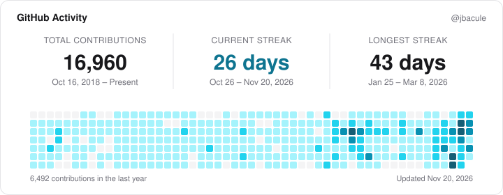

# Hi, I'm Josh Bacule 👋

**Tech Lead | Software Engineer** at [Global Ultrasound Institute](https://www.globalultrasoundinstitute.com) · Cebu, Philippines

I build web and mobile products for healthcare, fintech and operations teams, with 7+ years of shipping software.

## Currently Working On

- 🤖 **AI Development**: LLM-powered features, chatbots and AI tooling
- 📱 **Mobile App Development**: cross-platform apps with React Native
- 🌐 **Web Development**: TypeScript, React, Node.js and Astro

## GitHub Activity

<picture>
  <source media="(prefers-color-scheme: dark)" srcset="stats/streak-dark.svg">
  
</picture>

## Connect with Me

